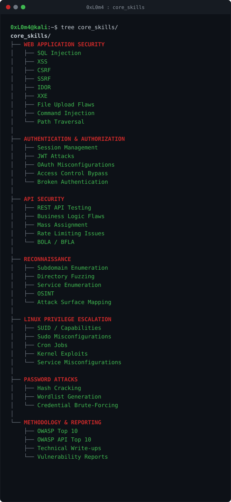

<!-- Animated Header -->

  

<!-- Typing Animation -->

  

  
  

---

## About Me

I'm **Salma Ashraf Hassan**, also known as **0xL0m4**.

A Computer Science & AI student focused on **Web Application Security, Penetration Testing, and Vulnerability Research**.

I enjoy exploring how applications work, identifying security weaknesses, and understanding how vulnerabilities can be discovered, exploited, and prevented.

My main areas of interest include:

- Web Application Security
- API Security Testing
- OWASP Top 10
- Vulnerability Research
- Linux Privilege Escalation
- Offensive Security Methodologies

I document my learning and findings through technical write-ups, CTF challenges, and security research.

## Security Arsenal

**Web & API Testing**

**Network, Exploitation & Cracking**

**Environment**

## Core Skills

  

## Tech Stack

**Languages**

**Frameworks & Libraries**

**Databases**

**AI & Data**

## Platforms & CTFs

## Writeups & Research

I document technical findings and practical security research, including:

- Hack The Box & TryHackMe Machines
- CTF Challenges and Walkthroughs
- Web Application Vulnerabilities
- API Security Testing
- Bug Bounty Research
- Linux Privilege Escalation

Explore my repositories for technical notes, solutions, and detailed exploitation walkthroughs.

## Currently Exploring

- Advanced Web Exploitation
- Android Penetration Testing
- Linux Privilege Escalation
- Professional Penetration Testing Methodologies

## GitHub Statistics

## Contribution Graph

<picture>
  <source media="(prefers-color-scheme: dark)" srcset="https://raw.githubusercontent.com/salma-ashraf10/salma-ashraf10/output/github-contribution-grid-snake-dark.svg">
  <source media="(prefers-color-scheme: light)" srcset="https://raw.githubusercontent.com/salma-ashraf10/salma-ashraf10/output/github-contribution-grid-snake.svg">
  
</picture>

## Connect With Me

---

**Don't forget to keep Palestine in your prayers.** 

